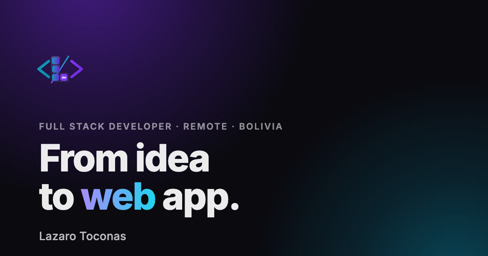

# Lazaro Toconas · Portfolio

Personal portfolio of Lazaro Toconas, a full stack developer working remotely from Bolivia. A single bilingual page (English and Spanish) with light and dark themes, built with React and Vite and deployed to GitHub Pages.

**Live site:** https://lazarus-99.github.io/portfolio/



## Tech stack

| Area | Tools |
| --- | --- |
| UI | [React 19](https://react.dev) |
| Build and dev server | [Vite](https://vite.dev) with `@vitejs/plugin-react` |
| Styling | Plain CSS with custom properties (design tokens per theme), no CSS framework |
| Animation | [Motion](https://motion.dev) (`motion/react`) for the scroll-driven tile reveal; CSS transitions and the View Transitions API for everything else |
| Icons | [Tabler Icons](https://tabler.io/icons) (`@tabler/icons-react`), plus a custom PostgreSQL icon |
| Fonts | [Inter](https://rsms.me/inter/) and [JetBrains Mono](https://www.jetbrains.com/lp/mono/), self-hosted (latin subset) |
| Linting | ESLint with the React Hooks and React Refresh plugins |
| Package manager | pnpm |
| Hosting | GitHub Pages, deployed by GitHub Actions |

There is no backend and no i18n or state-management library: translations, theme and language live in small React contexts.

## Features

- **Sections:** Home, About, Developer (experience and selected work), Teaching and Contact, with section snapping and a scroll-spy sidebar.
- **English and Spanish:** detects the browser language on the first visit (falls back to English) and remembers the choice.
- **Light and dark themes:** follows the system setting by default; switching themes plays a circular reveal from the toggle button (View Transitions API).
- **Typing headline:** "From idea to web / mobile / custom app.", with the typed word in the brand gradient.
- **Tile reveal:** the technologies fly in as tiles while you scroll into the Developer section.
- **Profile card:** a monochrome photo card that tilts toward the mouse, with a soft glare and a frosted-glass info bar.
- **Text loop:** a wavy ribbon of technologies scrolling along an SVG path in the Contact section; it pauses while hovered.
- **Motion polish:** scroll-triggered entrances, card hover states, press feedback on buttons and an iOS-like mobile menu, all on shared easing curves.
- **Mobile menu:** a full-screen frosted drawer behind a hamburger button.
- **Loader:** a logo loader rendered straight from `index.html`, shown until the app and fonts are ready.
- **Link previews:** Open Graph and Twitter card tags with a custom share image.

## Accessibility and performance

- Respects `prefers-reduced-motion`: animations become simple fades or stay still, and the tile reveal is replaced by a static layout.
- Semantic heading outline, screen-reader text for visual-only content (the typed headline, the tiles), and a menu whose links leave the tab order when it's closed.
- Hover effects only on devices with a precise pointer, so touch screens don't get stuck hover states.
- Code splitting: the Motion-based tile reveal loads only once the browser is idle after the first render.
- Background glows are radial gradients rather than large CSS blurs, which made weaker devices stutter.
- Fonts are preloaded from `index.html`, with a size-adjusted fallback to reduce layout shift.
- The saved theme is applied before the first paint, so there is no flash of the wrong theme.

## Getting started

Requirements: Node.js 20 or newer and pnpm.

```bash
pnpm install
pnpm dev
```

The dev server runs at http://localhost:5173/portfolio/ (the `/portfolio/` base path matches GitHub Pages).

To test on a phone on the same Wi-Fi network:

```bash
pnpm dev --host
```

## Scripts

| Command | What it does |
| --- | --- |
| `pnpm dev` | Starts the Vite dev server with hot reload |
| `pnpm build` | Builds the production site into `dist/` |
| `pnpm preview` | Serves the production build locally |
| `pnpm lint` | Runs ESLint |

## Project structure

```
public/            Static files: logos, share image, self-hosted fonts and their licenses
src/
  main.jsx         Entry point: theme and language providers
  App.jsx          Page layout and the hero section
  loader.js        Hides the index.html loader once the app is ready
  reveal.js        Scroll-triggered entrances for elements marked data-reveal
  components/      One folder per section or widget (about, developer, teaching,
                   contact, sidebar, textLoop, writer, background, toggles…)
  context/         Theme and language contexts
  hooks/           useTypewriterCycle, usePrefersReducedMotion
  data/            Skills and social links
  i18n/            English and Spanish copy (translations.js)
  assets/          Images imported by components
.github/workflows/ GitHub Pages deployment
```

## Editing content

- **Text, in both languages:** `src/i18n/translations.js`. Keep the `en` and `es` objects in the same shape.
- **Projects:** `developer.work.projects` in the same file.
- **Technologies in the tile reveal:** `src/data/skills.js`.
- **Contact links:** `src/data/socials.js`.
- **Share image:** `public/og-image-2.png` (1200×630). When you replace it, give it a new file name and update the `og:image` tag in `index.html`, otherwise chat apps keep showing the cached image.

## Deployment

Every push to `main` triggers `.github/workflows/deploy.yml`, which installs dependencies with pnpm, runs `pnpm build` and publishes `dist/` to GitHub Pages. It can also be run by hand from the Actions tab.

The site is served under `/portfolio/`, set as `base` in `vite.config.js`. If the Pages URL changes, update `base` there and the absolute URLs in the Open Graph tags in `index.html`.

## Credits

- The tile reveal, profile card and text loop are inspired by components from [React Bits](https://reactbits.dev).
- Inter and JetBrains Mono are licensed under the SIL Open Font License 1.1 (see `public/fonts/`).

## Contact

- Email: [lazaro.toconas19@gmail.com](mailto:lazaro.toconas19@gmail.com)
- LinkedIn: [lazaro-toconás](https://www.linkedin.com/in/lazaro-toconás-a87a971a4/)
- GitHub: [lazarus-99](https://github.com/lazarus-99)
